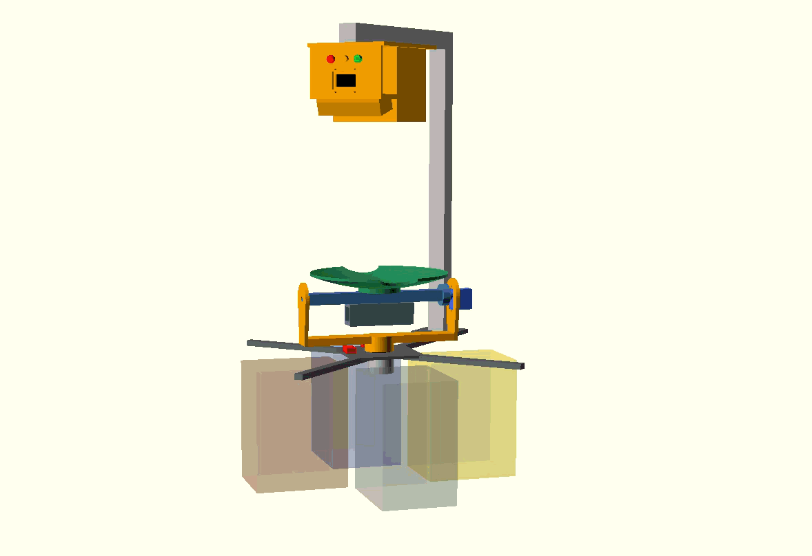

# Smart Tilting Bin

A refuse sorter that sees, hears and learns, built with reused materials.

A camera looks down at the object you drop in, an AI model decides which of four fractions it belongs to (packaging, paper, organic, general waste), and a rotating-tilting tray drops it into the right container. Two small motors reach four containers.

> Work in progress. This repository holds the parametric mechanical model and the simulation. It is part of my application to the element14 "My Project Is Trash" design challenge. Software and results will be added as the project advances.



## How it works

1. The user drops an object onto the tray, which rests horizontally.
2. An impact triggers a capture: a top-down Logitech C170 takes a photo and its microphone records the impact sound.
3. A Raspberry Pi CM4 classifies image and sound and maps the class to one of the four containers.
4. If the container is in line with the current tray position, the tray only tilts to +45 or -45 degrees. Otherwise the stepper first rotates the tray 90 degrees, stops, and then the tray tilts to the correct side.
5. The object slides through one of the two bites in the tray rim and falls into the container.
6. The tray returns to horizontal and LEDs and an OLED report the result.

```
               [ PAPER ]
                   |
 [ PACKAGING ] --- O --- [ ORGANIC ]
                   |
            [ GENERAL WASTE ]

 O = tray axis. At rotation 0 the tray tilts towards PAPER or
 GENERAL WASTE, at rotation 90 towards PACKAGING or ORGANIC.
```

## Mechanism

- **Base:** a fixed plate holds a 28BYJ-48 stepper (ULN2003 driver) with a vertical shaft. There is no solid disc under the tray, so objects fall freely.
- **Yoke:** a U-shaped yoke on the stepper shaft rotates between 0 and 90 degrees (two microswitches provide homing) and carries the tilt axis and an SG90 servo.
- **Tilt axis:** a horizontal beam. One end is a simple pivot and the other is coupled directly to the servo horn, so 90 degrees of servo travel gives +/-45 degrees of tilt.
- **Tray:** 150 mm, concave, with two round bites on the rim, perpendicular to the tilt axis.
- **Counterweight:** a printed holder under the beam with a sliding steel bar, so the servo hardly works at rest and the tray settles horizontal by itself.
- **Sensor support:** an "L" or arch bolted to a diagonal strut holds the camera above the tray. Its front wall faces the user and carries three LEDs, an OLED and, underneath, the IR light angle sensor aimed at the tray.

## Assembly of the compact yoke (`yoke_style = "compact"`)

Printed parts: `yoke`, `left_arm`, `beam`, `cradle`, `tray`, `counterweight` (export each one with the `part` parameter). The servo shaft is fixed to the right arm and the servo body rides with the tray, so the arm that holds the pivot pin has to be removable.

1. **Centre the servo.** Connect the SG90 and send it to 90 degrees (1500 us). Leave it powered.
2. **Servo into the cradle.** Slide the servo into the cradle from the open rear, boss first through the window, until its ears rest on the rear face of the plate. Fix the ears with two M2 self-tapping screws.
3. **Cradle onto the beam.** Slide the cradle over the end of the beam and clamp it with two M3 x 20 bolts (the nuts sit in the hex traps of the -y rail). Bolt the counterweight under the beam now, while it is easy to reach.
4. **Horn.** Press the single-arm horn into the pocket of the +x arm of the yoke.
5. **Beam into the yoke.** With the left arm removed, insert the beam from the -x side and hold the tray level (use a level). The spline enters the horn. Fix the horn with its M2 screw through the access hole of the arm.
6. **Left arm.** Slide it over the pivot pin and fix it to the end of the bar with two M3 screws.
7. **Tray.** Bolt the tray on top of the beam (two M3 screws).

Adjusting the neutral position: the servo spline has 21 teeth, so the horn can only be placed every 17 degrees, or every 8.6 degrees if you also try it rotated by 180 degrees (the horn is symmetric). Pick the position that leaves the tray closest to level at 90 degrees and trim the rest in software with an offset. As the shaft is fixed and the body moves, the direction is the opposite of the wide yoke: if the tray tilts the wrong way, flip the sign. Check with a level at 45 and 135 degrees that the tray reaches +/-45 degrees without touching the arms (the clearance is about 3 mm), and limit the software to that range.

Balance: before closing the yoke, rest the beam on two straight edges, under the pivot pin and under the servo boss. It should settle level, slightly heavy on the counterweight side. Adjust the length of the steel bar (the console prints an estimate).

Leave a service loop of about 6 cm in the servo cable and tie it to the cradle so it does not catch on the arm.

## Homing

Two CamdenBoss CSM40500A microswitches (button actuator, 1.5 N maximum operating force) define the rotation limits at 0 and 90 degrees. A ramped cam lobe on the yoke hub presses their radial buttons at a radius of 16 mm. The shallow ramp (15 degrees) and the small radius keep the torque needed to press them at roughly 10 mN*m, well under the 34.3 mN*m rated for the 28BYJ-48. The plateau of the lobe limits the button depth, hard stop posts limit the travel, and the switches sit on radial slots so you can tune the operating point by hand (the datasheet gives a tolerance of +/-0.4 mm). Approach the switches slowly (100-150 Hz) and stop the motor as soon as they trigger.

## Hardware

| Part | Role |
|---|---|
| Analog Devices EVAL-ADXL372Z | Vandalism and heavy-object protection, capture trigger, impact signature |
| Analog Devices EVAL-CN0569-PMDZ | IR gesture selection of the bin, labelling, game controller, hand detection |
| Hammond 1554X2GYCL (IP68) | Sealed enclosure for the electronics |
| CamdenBoss IND514113-LED | Green, amber and red status LEDs |
| CamdenBoss CTBP92HD/4 and CTBP93HD/4 | Pluggable terminal blocks |
| CamdenBoss CSM40500A | Limit switches for homing |

Complementary hardware (not in the kit): Raspberry Pi CM4 on a Waveshare CM4-NANO-A (or Pi 4 / Pi 5), Logitech C170, 28BYJ-48 with ULN2003, SG90 servo and an SSD1306 OLED.

## OpenSCAD model

Open `cad/smart_tilting_bin.scad` with OpenSCAD 2021.01 or later. Every dimension is a variable, so you can adapt the model to the materials you find (a salad bowl as the tray, a curtain-rod tube as the beam, and so on).

Main parameters:

| Parameter | Meaning |
|---|---|
| `part` | `"assembly"`, `"tray"`, `"beam"`, `"yoke"`, `"base"`, `"counterweight"` or `"camera_support"` (to export single STL files) |
| `yoke_style` | `"wide"` (arms outside the tray, servo on the yoke) or `"compact"` (short yoke with arms under the tray, servo riding with the tray: lower rotating inertia) |
| `yaw` | Tray rotation, 0 to 90 degrees |
| `tilt` | Tray tilt, -45 to +45 degrees |
| `animate` | `true` runs the sorting simulation of the four refuse types (View > Animate) |
| `show_bins`, `show_hw`, `show_cam` | Show containers, electronics and the camera support |
| `cam_support` | `"L"` or `"arch"` |
| `tray_d`, `dish_depth`, `bite_r` | Tray diameter, concavity and bite radius |
| `cw_bar_len` | Counterweight bar length (the console prints an estimate of the balance) |
| `cam_view_d` | Diameter of the tray area the camera must see |

The console prints the estimated balance of the tray, the camera height and the aim angle of the IR sensor.

Dimensions of the commercial parts (28BYJ-48, SG90, Logitech C170, SSD1306) are typical values, so check them against your own parts.

## Render the animation

With OpenSCAD and ffmpeg installed:

```
./scripts/render_gif.sh
```

Or with the OpenSCAD GUI: set `animate = true`, open View > Animate with 160 steps and 20 FPS, check "Dump Pictures", and turn the PNG frames into a GIF with ffmpeg.

## Reusing materials

Most of the mechanism can be built from waste: a plastic bowl or wok lid as the tray, a curtain-rod tube as the tilt beam, a cutting board or pallet wood for the base, a bottle cap as the sliding washer, a paper tube as the sensor visor, a food container lid as the LED panel, and nuts and bolts as the counterweight. Motors, servo, sensors and electronics are new.

## Status

- [x] Parametric OpenSCAD model and sorting simulation
- [ ] Mechanism build and calibration
- [ ] Electronics and wiring
- [ ] Vision classifier (offline and online)
- [ ] Sound classifier and sensor fusion
- [ ] Gesture selection, labelling and game mode
- [ ] Vandalism detection

## License

- CC BY-SA 4.0 for the CAD files 
- MIT for the code
